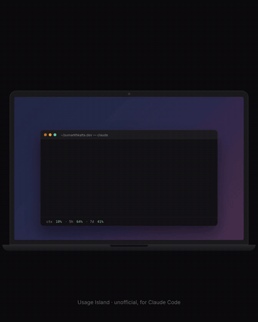

# Claude Island

A Dynamic-Island-style pill for Windows that shows your Claude usage limits at the top center of your screen, right under the camera.

> **Unofficial side project. Not affiliated with, endorsed by, or made by Anthropic.**



*Animated concept demo*

## Why

I use Claude Code a lot and kept hitting the 5-hour limit without warning. Claude Code already knows your usage numbers. This app just puts them on screen where you can always see them.

## Features

- **Collapsed pill:** session %, reset time and weekly %, color-coded green, amber and red
- **Click to expand:** session, weekly and Fable bars with reset times
- **Burn rate** and a "you'll hit the limit around X" forecast
- **Weekly pacing:** "Day 4 of 7, on track" or "ahead of pace"
- **7-day history** mini chart
- **Alerts:** the pill flashes amber at 80%, turns red at 95%, and shows "Limit refreshed" when your window resets
- **Ctrl + Alt + U** to show or hide it, a tray icon, and an optional start-with-Windows setting

## How it works

```
Claude Code ──(status line JSON)──▶ island-statusline.js ──▶ ~/.claude/usage-island.json ──▶ Island app
```

Claude Code passes the official `rate_limits` (5-hour and 7-day) to your status line on Pro and Max plans. The script saves those numbers locally and prints your normal status line. The Electron app watches that file. Nothing leaves your machine, and it doesn't scrape claude.ai or use private endpoints.

## Setup (Windows)

Requires [Node.js](https://nodejs.org) LTS.

**Easiest:** download this repo, open the Code tab in the Claude desktop app, and ask Claude to set it up by following this README.

**Manual:**

1. Copy `statusline/island-statusline.js` to `C:\Users\<you>\.claude\island-statusline.js`
2. In `C:\Users\<you>\.claude\settings.json`, set:
   ```json
   "statusLine": {
     "type": "command",
     "command": "node C:/Users/<you>/.claude/island-statusline.js"
   }
   ```
3. Run:
   ```
   cd island
   npm install
   ```
4. Double-click `start-island.bat`
5. Send a message in Claude Code and the pill fills in.

## Limitations

- Numbers refresh only when Claude Code gets a response. Usage from claude.ai chats shows up at the next Claude Code reply. Data older than 10 minutes is marked amber.
- Live limits need a Pro or Max plan, and appear after the first response in a session.
- Built and tested on a virtual display. Windows testing is in progress, so please open an issue if something breaks.
- It's an Electron app, so it uses about 100 MB of RAM. A lighter Tauri version may come later.

## License

MIT
